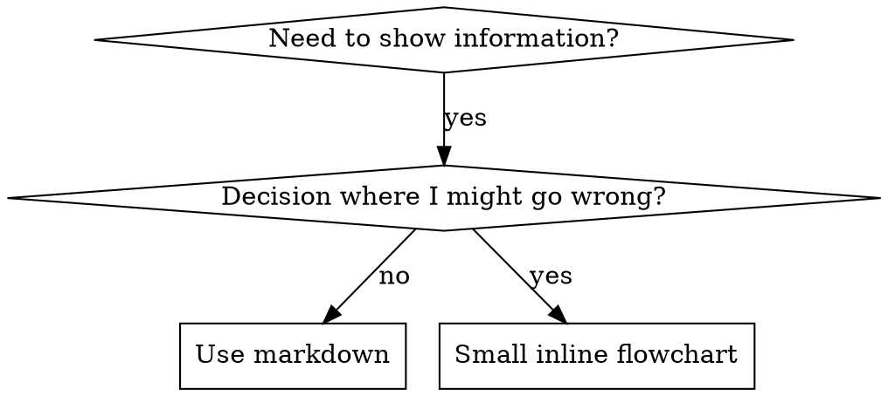

# Writing Skills

## Overview

**Writing skills IS Test-Driven Development applied to process documentation.**

**Personal skills live in agent-specific directories (`~/.claude/skills` for Claude Code, `~/.agents/skills/` for Codex)**

You write test cases (pressure scenarios with subagents), watch them fail (baseline behavior), write the skill (documentation), watch tests pass (agents comply), and refactor (close loopholes).

**Core principle:** If you didn't watch an agent fail without the skill, you don't know if the skill teaches the right thing.

**REQUIRED BACKGROUND:** You MUST understand runes:test-driven-development before using this skill. That skill defines the fundamental RED-GREEN-REFACTOR cycle. This skill adapts TDD to documentation.

**Official guidance:** This skill follows Anthropic's [Skill authoring best practices](https://platform.claude.com/docs/en/agents-and-tools/agent-skills/best-practices) and states the rules that apply here. Where the two differ, this skill says how and why. Fetch the official page only when writing a skill that bundles executable scripts or needs an evaluation suite. It covers those in more depth than this skill does.

## What is a Skill?

A **skill** is a reference guide for proven techniques, patterns, or tools. Skills help future Claude instances find and apply effective approaches.

**Skills are:** Reusable techniques, patterns, tools, reference guides

**Skills are NOT:** Narratives about how you solved a problem once

## TDD Mapping for Skills

| TDD Concept | Skill Creation |
|-------------|----------------|
| **Test case** | Pressure scenario with subagent |
| **Production code** | Skill document (SKILL.md) |
| **Test fails (RED)** | Agent violates rule without skill (baseline) |
| **Test passes (GREEN)** | Agent complies with skill present |
| **Refactor** | Close loopholes while maintaining compliance |
| **Write test first** | Run baseline scenario BEFORE writing skill |
| **Watch it fail** | Document exact rationalizations agent uses |
| **Minimal code** | Write skill addressing those specific violations |
| **Watch it pass** | Verify agent now complies |
| **Refactor cycle** | Find new rationalizations → plug → re-verify |

The entire skill creation process follows RED-GREEN-REFACTOR.

## When to Create a Skill

**Create when:**
- Technique wasn't intuitively obvious to you
- You'd reference this again across projects
- Pattern applies broadly (not project-specific)
- Others would benefit

**Don't create for:**
- One-off solutions
- Standard practices well-documented elsewhere
- Project-specific conventions (put in CLAUDE.md)
- Mechanical constraints (if it's enforceable with regex/validation, automate it—save documentation for judgment calls)

## Skill Types

### Technique
Concrete method with steps to follow (condition-based-waiting, root-cause-tracing)

### Pattern
Way of thinking about problems (flatten-with-flags, test-invariants)

### Reference
API docs, syntax guides, tool documentation (office docs)

## Directory Structure


```
skills/
  skill-name/
    SKILL.md              # Main reference (required)
    supporting-file.*     # Only if needed
```

**Flat namespace** - all skills in one searchable namespace

**Separate files for:**
1. **Heavy reference** (100+ lines) - API docs, comprehensive syntax
2. **Reusable tools** - Scripts, utilities, templates

**Keep inline:**
- Principles and concepts
- Code patterns (< 50 lines)
- Everything else

**Rules for supporting files** (from the official guide):
- Keep the SKILL.md body **under 500 lines**. Past that, move heavy sections into a supporting file.
- Link every supporting file **directly from SKILL.md** (one level deep). Claude may only preview a file that is linked from another supporting file (`head -100`), so it misses content.
- Give any supporting file over 100 lines a **table of contents** at the top.
- Use forward slashes in paths (`reference/guide.md`), and name files by content (`form-validation-rules.md`, not `doc2.md`).
- For a script, state whether Claude should **run** it ("Run `validate.py`") or **read** it as reference.

## SKILL.md Structure

**Frontmatter (YAML):**
- Two required fields: `name` and `description` (see [agentskills.io/specification](https://agentskills.io/specification) for all supported fields)
- `name`:
  - At most 64 characters
  - **Lowercase** letters, numbers, and hyphens only (no capitals, spaces, parentheses, or other special characters)
  - Must not contain the reserved words `anthropic` or `claude`, or XML tags
  - Match the skill's directory name
- `description`:
  - Non-empty, at most 1024 characters, no XML tags (`<` `>`)
  - Written in third person
  - Says what the skill covers and when to use it. Start with "Use when..." to focus on triggering conditions.
  - Include specific symptoms, situations, and contexts
  - **NEVER summarize the skill's process or workflow** (see CSO section for why)
  - Keep under 500 characters if possible

If the user asks for a name that breaks these rules (`Claude-PDF-Forms`), use a compliant one (`filling-pdf-forms`) and say why.

```markdown
---
name: skill-name-with-hyphens
description: Use when [specific triggering conditions and symptoms]
---

# Skill Name

## Overview
What is this? Core principle in 1-2 sentences.

## When to Use
[Small inline flowchart IF decision non-obvious]

Bullet list with SYMPTOMS and use cases
When NOT to use

## Core Pattern (for techniques/patterns)
Before/after code comparison

## Quick Reference
Table or bullets for scanning common operations

## Implementation
Inline code for simple patterns
Link to file for heavy reference or reusable tools

## Common Mistakes
What goes wrong + fixes

## Real-World Impact (optional)
Concrete results
```


## Claude Search Optimization (CSO)

**Critical for discovery:** Future Claude needs to FIND your skill

### 1. Rich Description Field

**Purpose:** Claude reads description to decide which skills to load for a given task. Make it answer: "Should I read this skill right now?"

**CRITICAL: Description = When to Use and What It Covers, NOT How It Works**

The description states the triggering conditions and, at most, the domain the skill covers. Do NOT summarize the skill's process or workflow in the description.

**Why this matters:** Testing revealed that when a description summarizes the skill's workflow, Claude may follow the description instead of reading the full skill content. A description saying "code review between tasks" caused Claude to do ONE review, even though the skill's flowchart clearly showed TWO reviews (spec compliance then code quality).

When the description was changed to just "Use when executing implementation plans with independent tasks" (no workflow summary), Claude correctly read the flowchart and followed the two-stage review process.

**The trap:** Descriptions that summarize workflow create a shortcut Claude will take. The skill body becomes documentation Claude skips.

**How this relates to the official guide:** The official guide says a description covers "what the Skill does and when to use it". Keep the *what* to the domain or artifact the skill covers ("PDF forms", "ops runbooks"), which helps Claude pick the right skill. Leave out the *how*: steps, order, or number of passes.

```yaml
# ❌ BAD: Summarizes workflow - Claude may follow this instead of reading skill
description: Use when executing plans - dispatches subagent per task with code review between tasks

# ❌ BAD: Too much process detail
description: Use for TDD - write test first, watch it fail, write minimal code, refactor

# ✅ GOOD: When to use, no workflow summary
description: Use when executing a written implementation plan with subagents available and mostly independent tasks

# ✅ GOOD: When to use; the domain (features, bugfixes) is part of the trigger
description: Use when implementing any feature or bugfix, before writing implementation code
```

**Content:**
- Use concrete triggers, symptoms, and situations that signal this skill applies
- Describe the *problem* (race conditions, inconsistent behavior) not *language-specific symptoms* (setTimeout, sleep)
- Keep triggers technology-agnostic unless the skill itself is technology-specific
- If skill is technology-specific, make that explicit in the trigger
- Write in third person (injected into system prompt)
- **NEVER summarize the skill's process or workflow**

```yaml
# ❌ BAD: Too abstract, vague, doesn't include when to use
description: For async testing

# ❌ BAD: First person
description: I can help you with async tests when they're flaky

# ❌ BAD: Mentions technology but skill isn't specific to it
description: Use when tests use setTimeout/sleep and are flaky

# ✅ GOOD: Starts with "Use when", describes problem, no workflow
description: Use when tests have race conditions, timing dependencies, or pass/fail inconsistently

# ✅ GOOD: Technology-specific skill with explicit trigger
description: Use when using React Router and handling authentication redirects
```

### 2. Keyword Coverage

Use words Claude would search for:
- Error messages: "Hook timed out", "ENOTEMPTY", "race condition"
- Symptoms: "flaky", "hanging", "zombie", "pollution"
- Synonyms: "timeout/hang/freeze", "cleanup/teardown/afterEach"
- Tools: Actual commands, library names, file types

### 3. Descriptive Naming

**Use active voice, verb-first, named by what you DO or the core insight:**
- ✅ `creating-skills` not `skill-creation`
- ✅ `condition-based-waiting` not `async-test-helpers`
- ✅ `root-cause-tracing` not `debugging-techniques`
- ❌ Vague or generic: `helper`, `utils`, `documents`

**Gerunds (-ing) work well for processes:** `creating-skills`, `testing-skills`, `debugging-with-logs`

### 4. Token Efficiency (Critical)

**Problem:** getting-started and frequently-referenced skills load into EVERY conversation. Every token counts.

**Target word counts:**
- getting-started workflows: <150 words each
- Frequently-loaded skills: <200 words total
- Other skills: <500 words (still be concise)

**Techniques:**

**Move details to tool help:**
```bash
# ❌ BAD: Document all flags in SKILL.md
search-conversations supports --text, --both, --after DATE, --before DATE, --limit N

# ✅ GOOD: Reference --help
search-conversations supports multiple modes and filters. Run --help for details.
```

**Use cross-references:**
```markdown
# ❌ BAD: Repeat workflow details
When searching, dispatch subagent with template...
[20 lines of repeated instructions]

# ✅ GOOD: Reference other skill
Always use subagents (50-100x context savings). REQUIRED: Use [other-skill-name] for workflow.
```

**Eliminate redundancy:**
- Don't repeat what's in cross-referenced skills
- Don't explain what's obvious from command
- Don't include multiple examples of same pattern

**Verification:**
```bash
wc -w skills/path/SKILL.md
# getting-started workflows: aim for <150 each
# Other frequently-loaded: aim for <200 total
```

**Don't explain what Claude already knows.** For each paragraph, ask "Does Claude really need this?" Spend tokens on what is specific to this domain or team, not on general knowledge.

### 5. Consistent Terminology and Tool Names

- Pick one term per concept and use it throughout ("PR review thread", not a mix of "thread", "comment", and "conversation").
- Refer to MCP tools by their fully qualified name (`ServerName:tool_name`, or `mcp__server__tool` in Claude Code). Without the server prefix, Claude may not find the tool when several servers are connected.
- Avoid time-sensitive statements ("until August 2025, use..."). Put the current method first. If old behavior still matters, put it under a collapsed "Old patterns" note.

### 6. Cross-Referencing Other Skills

**When writing documentation that references other skills:**

Use skill name only, with explicit requirement markers:
- ✅ Good: `**REQUIRED SUB-SKILL:** Use runes:test-driven-development`
- ✅ Good: `**REQUIRED BACKGROUND:** You MUST understand runes:systematic-debugging`
- ❌ Bad: `See skills/testing/test-driven-development` (unclear if required)
- ❌ Bad: `@skills/testing/test-driven-development/SKILL.md` (force-loads, burns context)

**Why no @ links:** `@` syntax force-loads files immediately, consuming 200k+ context before you need them. The same applies to files inside your own skill: link them with a plain relative Markdown link (`[testing-skills-with-subagents.md](testing-skills-with-subagents.md)`), not `@file`.

## Workflows and Feedback Loops

- For a multi-step task, give a checklist Claude can copy and tick off, so it doesn't skip a step.
- For quality-critical output, build in a loop: run the validator (a script, or a checklist file Claude compares against), fix what it reports, and run it again until it passes.

## Flowchart Usage



**Use flowcharts ONLY for:**
- Non-obvious decision points
- Process loops where you might stop too early
- "When to use A vs B" decisions

**Never use flowcharts for:**
- Reference material → Tables, lists
- Code examples → Markdown blocks
- Linear instructions → Numbered lists
- Labels without semantic meaning (step1, helper2)

For graphviz style rules (node shapes, edge labels, naming), read [graphviz-conventions.dot](graphviz-conventions.dot) as reference. It is a style guide written in DOT, not a script.

**Visualizing for your human partner:** Run `render-graphs.js` (no need to read it) from this directory to render a skill's `dot` blocks to SVG files in `<skill>/diagrams/`. It needs Node.js and graphviz (`dot`):
```bash
./render-graphs.js ../some-skill           # Each diagram separately
./render-graphs.js ../some-skill --combine # All diagrams in one SVG
```

## Code Examples

**One excellent example beats many mediocre ones.** Pick the most relevant language (testing → TypeScript/JavaScript, system debugging → shell/Python, data processing → Python). A good example is complete and runnable, comes from a real scenario, and has comments explaining WHY. Don't implement it in 5+ languages, write fill-in-the-blank templates, or invent contrived cases. Claude is good at porting, so one great example is enough.

## File Organization

| Layout | Example | When |
|--------|---------|------|
| Self-contained | `defense-in-depth/SKILL.md` | Everything fits inline |
| With reusable tool | `condition-based-waiting/{SKILL.md, example.ts}` | Tool is reusable code, not narrative |
| With heavy reference | `pptx/{SKILL.md, pptxgenjs.md, ooxml.md, scripts/}` | Reference too large for inline; link each file from SKILL.md |

## The Iron Law (Same as TDD)

```
NO SKILL WITHOUT A FAILING TEST FIRST
```

This applies to NEW skills AND EDITS to existing skills.

Write skill before testing? Delete it. Start over.
Edit skill without testing? Same violation.

**No exceptions:**
- Not for "simple additions"
- Not for "just adding a section"
- Not for "documentation updates"
- Don't keep untested changes as "reference"
- Don't "adapt" while running tests
- Delete means delete

**REQUIRED BACKGROUND:** The runes:test-driven-development skill explains why this matters. Same principles apply to documentation.

## Testing All Skill Types

Every skill type gets tested, but the test differs: pressure scenarios for discipline skills, application and edge-case scenarios for techniques, recognition and counter-example scenarios for patterns, and retrieval scenarios for references. See "Testing by Skill Type" in [testing-skills-with-subagents.md](testing-skills-with-subagents.md).

## Common Rationalizations for Skipping Testing

| Excuse | Reality |
|--------|---------|
| "Skill is obviously clear" | Clear to you ≠ clear to other agents. Test it. |
| "It's just a reference" | References can have gaps, unclear sections. Test retrieval. |
| "Testing is overkill" | Untested skills have issues. Always. 15 min testing saves hours. |
| "I'll test if problems emerge" | Problems = agents can't use skill. Test BEFORE deploying. |
| "Too tedious to test" | Testing is less tedious than debugging bad skill in production. |
| "I'm confident it's good" | Overconfidence guarantees issues. Test anyway. |
| "Academic review is enough" | Reading ≠ using. Test application scenarios. |
| "No time to test" | Deploying untested skill wastes more time fixing it later. |

**All of these mean: Test before deploying. No exceptions.**

## Bulletproofing Skills Against Rationalization

Skills that enforce discipline (like TDD) need to resist rationalization. Agents are smart and will find loopholes when under pressure. For each rationalization you see in testing, add:

1. **An explicit negation** that forbids the specific workaround ("Don't keep it as 'reference'. Delete means delete.")
2. **A foundational principle** early on: "**Violating the letter of the rules is violating the spirit of the rules.**" This cuts off "I'm following the spirit" arguments.
3. **A rationalization table row** (`| Excuse | Reality |`) taken verbatim from baseline runs
4. **A red flags list** agents can self-check against ("Code before test", "This is different because...")
5. **Description symptoms** for the moment just before a violation ("before writing implementation code")

Worked examples of each are in "REFACTOR Phase" of [testing-skills-with-subagents.md](testing-skills-with-subagents.md). For why these work, see [persuasion-principles.md](persuasion-principles.md) (Cialdini, 2021; Meincke et al., 2025).

## RED-GREEN-REFACTOR for Skills

1. **RED:** Run the scenario with a subagent WITHOUT the skill. Record its choices, its rationalizations verbatim, and which pressures caused violations.
2. **GREEN:** Write the minimal skill that addresses those specific failures, with nothing for hypothetical cases. Rerun with the skill and confirm the agent complies.
3. **REFACTOR:** Found a new rationalization? Add an explicit counter and retest until it holds.

**Testing methodology:** [testing-skills-with-subagents.md](testing-skills-with-subagents.md) covers writing pressure scenarios, pressure types (time, sunk cost, authority, exhaustion), plugging holes, and meta-testing. [examples/CLAUDE_MD_TESTING.md](examples/CLAUDE_MD_TESTING.md) is a full worked test campaign.

**Test with every model you'll run the skill on.** Haiku may need more guidance than Opus, and Opus may find detail that helps Haiku redundant.

## Anti-Patterns

### ❌ Narrative Example
"In session 2025-10-03, we found empty projectDir caused..."
**Why bad:** Too specific, not reusable

### ❌ Multi-Language Dilution
example-js.js, example-py.py, example-go.go
**Why bad:** Mediocre quality, maintenance burden

### ❌ Code in Flowcharts
```dot
step1 [label="import fs"];
step2 [label="read file"];
```
**Why bad:** Can't copy-paste, hard to read

### ❌ Generic Labels
helper1, helper2, step3, pattern4
**Why bad:** Labels should have semantic meaning

## STOP: Before Moving to Next Skill

**After writing ANY skill, you MUST STOP and complete the deployment process.**

**Do NOT:**
- Create multiple skills in batch without testing each
- Move to next skill before current one is verified
- Skip testing because "batching is more efficient"

**The deployment checklist below is MANDATORY for EACH skill.**

Deploying untested skills = deploying untested code. It's a violation of quality standards.

## Skill Creation Checklist (TDD Adapted)

**IMPORTANT: Use TodoWrite to create todos for EACH checklist item below.**

**RED Phase - Write Failing Test:**
- [ ] Create pressure scenarios (3+ combined pressures for discipline skills)
- [ ] Run scenarios WITHOUT skill - document baseline behavior verbatim
- [ ] Identify patterns in rationalizations/failures

**GREEN Phase - Write Minimal Skill:**
- [ ] Name: ≤64 chars, lowercase letters/numbers/hyphens only, no `anthropic`/`claude`, matches directory
- [ ] YAML frontmatter with required `name` and `description` fields (description ≤1024 chars, no XML tags; see [spec](https://agentskills.io/specification))
- [ ] Description starts with "Use when...", includes specific triggers/symptoms, and doesn't summarize the workflow
- [ ] Description written in third person
- [ ] Keywords throughout for search (errors, symptoms, tools)
- [ ] Clear overview with core principle
- [ ] Address specific baseline failures identified in RED
- [ ] Code inline OR link to separate file
- [ ] One excellent example (not multi-language)
- [ ] Run scenarios WITH skill - verify agents now comply

**REFACTOR Phase - Close Loopholes:**
- [ ] Identify NEW rationalizations from testing
- [ ] Add explicit counters (if discipline skill)
- [ ] Build rationalization table from all test iterations
- [ ] Create red flags list
- [ ] Re-test until bulletproof

**Quality Checks:**
- [ ] Small flowchart only if decision non-obvious
- [ ] Quick reference table
- [ ] Common mistakes section
- [ ] No narrative storytelling
- [ ] Supporting files only for tools or heavy reference
- [ ] SKILL.md body under 500 lines
- [ ] Supporting files linked directly from SKILL.md (one level deep), with plain links, not `@`
- [ ] Supporting files over 100 lines start with a table of contents
- [ ] Consistent terminology; MCP tools fully qualified; no time-sensitive statements

**Deployment:**
- [ ] Commit skill to git and push to your fork (if configured)
- [ ] Consider contributing back via PR (if broadly useful)

## Discovery Workflow

How future Claude finds your skill:

1. **Encounters problem** ("tests are flaky")
2. **Finds SKILL** (description matches)
3. **Scans overview** (is this relevant?)
4. **Reads patterns** (quick reference table)
5. **Loads example** (only when implementing)

**Optimize for this flow** - put searchable terms early and often.

## The Bottom Line

**Creating skills IS TDD for process documentation.**

Same Iron Law: No skill without failing test first.
Same cycle: RED (baseline) → GREEN (write skill) → REFACTOR (close loopholes).
Same benefits: Better quality, fewer surprises, bulletproof results.

If you follow TDD for code, follow it for skills. It's the same discipline applied to documentation.
